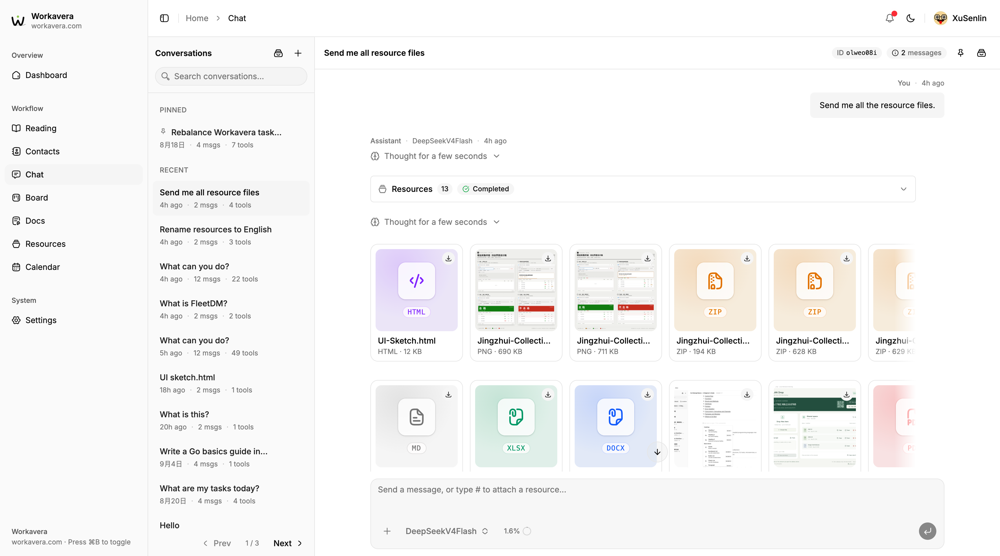

# Workavera

[](./LICENSE)

[English](./README.md)

> **项目、文档、日历和文件都在一个自托管工作区里，还有一个真正能把事情做完的 AI 助手。**

> 🎉 **沙箱和资源管理上线啦！** 把文件放进 **Resources**，就能在任意对话里附加；再打开属于你自己的 **沙箱**，助手就能跑脚本、处理你的文件，并把结果存回工作区。详见 [Chat 发送资源文件](#chat-发送资源文件)和[沙箱](#沙箱sandbox)。🥳

> ⚠️ **项目处于早期开发阶段（0.x）。** 功能仍在快速迭代，版本之间可能包含破坏性变更（见[更新日志](./CHANGELOG.md)）。升级前请备份数据，暂不建议用于生产环境。

Workavera 是为自由职业者和小团队打造的工作区：规划项目、撰写文档、安排日程、收藏稍后读的内容、保存你的文件，全部跑在你自己的服务器上。Chat 把这一切串起来：让助手规划一个项目、汇总本周到期的事项、回答关于某份 PDF 的问题，或者整理你的文件，它都会直接在工作区里完成，而且权限和你的账号完全一致。

## 你可以用它做什么

- **用 Board 规划项目。** 看板支持自定义流程状态、标签、成员和截止日期，并内置十套中英文项目模板。还可以通过公开链接，把只读的项目时间线分享给客户。
- **用 Docs 写作和分享。** 富文本编辑器支持版本历史、Markdown 与 HTML 导出和 AI 编辑。文档可以发布为公开页面，没有账号也能阅读。
- **用 Calendar 查看日程。** 个人日程与 Board 截止日期在同一视图中，支持重复日程和提醒。
- **在 Chat 里把事情做完。** 助手会搜索你的工作区，创建和更新任务、日程与文档，并展示它的思考过程和每一步操作。关掉浏览器对话也会继续运行，需要时还可以打开长期记忆。
- **用 Resources 管理文件。** 上传 PDF、Office 文档、文本、代码、图片和压缩包，可以搜索、按类型过滤，并在 Chat 中用 `+` 或 `#` 附加。助手能读懂文档里的文字，你可以直接就文件内容提问。
- **让助手在沙箱里干活。** 打开属于你自己的 Linux 工作空间，助手就能对你的文件运行命令和 Python、Node 脚本——给扫描版 PDF 做 OCR、清理表格、批量重命名文件——并把结果存回 Resources 和 Docs。
- **阅读、发现与总结。** 把链接和笔记存进 Reading，在 Discover 里关注喜欢的信息源，并用 AI 总结最新内容。
- **在 Contacts 里找到团队成员。** 可搜索的团队通讯录，支持个人收藏。

## 为什么选 Workavera

- **助手真的会动手，而不只是聊天。** 大多数自托管 AI 工具要么只是套在模型外面的聊天窗口，要么是附带 AI 写作助手的笔记应用。在 Workavera 里，助手直接操作你的工作区，而且永远不会超出你账号本来的权限。
- **数据始终在你手里。** 所有内容都在你自己的服务器上，没有遥测，也没有厂商后端。可以用你已经在付费的模型服务，也可以用跑在自己电脑上的模型，让数据完全不离开你的设备。
- **原生移动客户端。** Android 和 iOS 客户端原生开发、完全开源，适配手机和平板，并提供日程桌面小组件，不是把网页套个壳。详见[移动客户端](#移动客户端)。
- **部署简单。** 纯 Go 编写、无 CGO 依赖，网页和数据库都打包进一个自包含的二进制文件。下载一个文件或一条 `docker run` 就能跑起来，不用装运行环境，也不用搭数据库。
- **能和你已有的 AI 工具协作。** 用 API Key 把 Claude Code、Cursor 等 MCP 客户端接入你的工作区，也可以把外部 MCP 工具接入 Chat。

## 产品截图

### Dashboard 工作概览


### DeepSeek 调用工作区工具


### Chat 发送资源文件



### Board 中文项目看板


### Board 公开时间线


### Calendar 统一日程


### Docs 文档编辑器


### 文档公开分享


### Discover 订阅发现与 AI 总结


### 本地模型配置


## 快速开始

用 Docker 运行 Workavera：

```bash
docker run -p 8090:8090 -v workavera-data:/app/pb_data ghcr.io/xusenlin/workavera:latest
```

或者从 [GitHub Releases](https://github.com/xusenlin/workavera/releases) 下载对应平台的二进制，然后运行 `./workavera serve`。

打开 <http://127.0.0.1:8090>，用账号 `demo@workavera.local`、密码 `workavera` 登录，在 Profile 中修改密码，再到 Settings 里添加一个模型，就可以开始使用 Chat 了。管理员账号、本地模型、服务器要求和实例设置见[自托管指南](./doc/self-hosting.zh-CN.md)。

### 沙箱（Sandbox）

沙箱是可选功能：在 **Settings → Sandbox** 中开启后，每位用户都会获得一个属于自己的 Linux 工作空间，助手可以在里面运行命令和脚本，并在沙箱与 Resources、Docs 之间搬运文件。它需要服务器上安装 Docker，并以下载的二进制而不是 Docker 镜像运行 Workavera；部署方式和安全提醒见[自托管指南中的沙箱部分](./doc/self-hosting.zh-CN.md#沙箱sandbox)。

## 移动客户端

Workavera 原生开源的 Android 和 iOS 客户端已经正式上线。它们直接连接你自己的服务器，把 Board、Docs、Calendar、Chat、Reading、Contacts 和通知装进手机和平板；日程桌面小组件让你一眼看到接下来的截止事项和日程。

- **[从 GitHub Releases 下载 Workavera Android 客户端](https://github.com/xusenlin/workavera-android/releases/latest)。**
  使用 Kotlin 与 Jetpack Compose 开发，[源码](https://github.com/xusenlin/workavera-android)已开源。
- **[前往 App Store 获取 Workavera iOS 客户端](https://apps.apple.com/app/workavera/id6794339518)。**
  原生 SwiftUI 客户端，适配 iPhone 与 iPad，[源码](https://github.com/xusenlin/workavera-ios)已开源。

### 服务端版本要求

客户端需要的服务端版本不能低于下表；升级时先升服务端，再升客户端。

| Android / iOS | 要求服务端 | 原因 |
| --- | --- | --- |
| 1.0.4 | 0.1.1 及以上 | 任务开始日期、项目公开链接与订阅发现 |
| 1.0.2 | 0.0.10 及以上 | 任务归档需要 `board_tasks.archived` |
| 1.0.1 | 0.0.9 及以上 | 自建 MCP 服务需要 `mcp_servers` |

## 文档与路线图

[自托管指南](./doc/self-hosting.zh-CN.md)介绍安装、首次运行、隐私与本地模型、沙箱，以及从源码构建。

下面的路线图列出每项功能首次上线的服务端版本：✅ 已完成，⬜ 尚未开始。产品文档标为“待审核”的提案正在征求意见，审核通过后才会开始开发。

| | 功能 | 版本 | 产品文档 |
| --- | --- | --- | --- |
| ✅ | Board 看板 | 0.0.1 | [中文](./doc/board-prd.zh-CN.md) · [English](./doc/board-prd.md) |
| ✅ | Calendar 日历 | 0.0.1 | [中文](./doc/calendar-prd.zh-CN.md) · [English](./doc/calendar-prd.md) |
| ✅ | Chat 对话 | 0.0.1 | [中文](./doc/chat-fantasy-plan.zh-CN.md) · [English](./doc/chat-fantasy-plan.md) |
| ✅ | Docs 文档 | 0.0.1 | [中文](./doc/docs-prd.zh-CN.md) · [English](./doc/docs-prd.md) |
| ✅ | Reading 稍后读 | 0.0.1 | — |
| ✅ | Contacts 通讯录 | 0.0.1 | — |
| ✅ | 供 Claude Code、Cursor 等客户端接入的 MCP | 0.0.7 | — |
| ✅ | Chat 长期记忆 | 0.0.8 | [中文](./doc/chat-memory-prd.zh-CN.md) · [English](./doc/chat-memory-prd.md) |
| ✅ | 在 Chat 中接入自己的 MCP 服务 | 0.0.9 | [中文](./doc/mcp-client-prd.zh-CN.md) · [English](./doc/mcp-client-prd.md) |
| ✅ | 文档公开链接 | 0.1.0 | — |
| ✅ | 项目公开时间线 | 0.1.1 | [中文](./doc/board-public-preview-prd.zh-CN.md) · [English](./doc/board-public-preview-prd.md) |
| ✅ | Discover 订阅发现与 AI 总结 | 0.1.1 | — |
| ✅ | Resources 资源管理 | 0.2.0 | [中文](./doc/resources-prd.zh-CN.md) · [English](./doc/resources-prd.md) |
| ✅ | 沙箱 | 0.2.0 | [中文](./doc/sandbox-prd.zh-CN.md) · [English](./doc/sandbox-prd.md) |
| ⬜ | 定时任务 | 计划中 | [中文](./doc/scheduled-tasks-prd.zh-CN.md) · [English](./doc/scheduled-tasks-prd.md)（待审核） |

## 更新日志

版本历史见 [CHANGELOG.md](./CHANGELOG.md)。

## 许可证

基于 [Apache License 2.0](./LICENSE) 授权。

Copyright 2026 xusenlin
